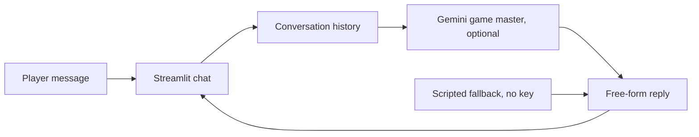
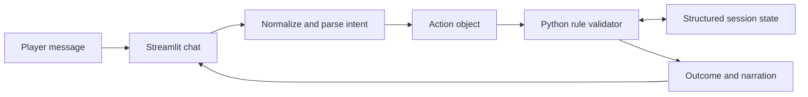

# Architecture

## Version 1 — AI-led

Conversation text provides continuity, but there is no structured game state or authoritative check. When Gemini is configured, it decides what happened in its reply. The fallback supports a few common actions only.

## Version 2 — Rules-first

Python owns puzzle answers, inventory, prerequisites, and completion. No model can directly write state. Invalid actions return feedback without corrupting progress; the state lives in the Streamlit session.
